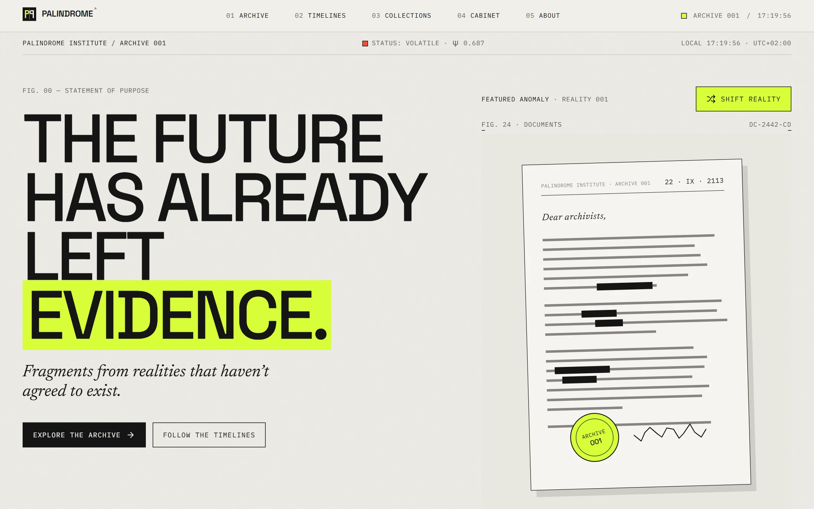
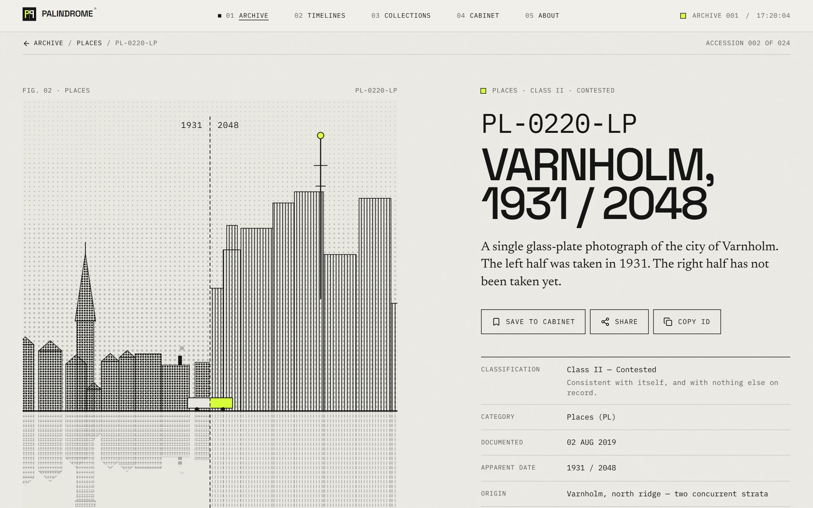
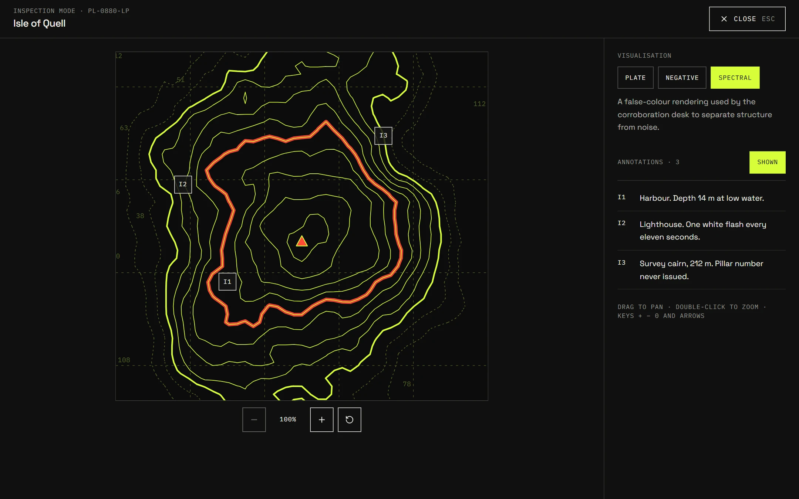
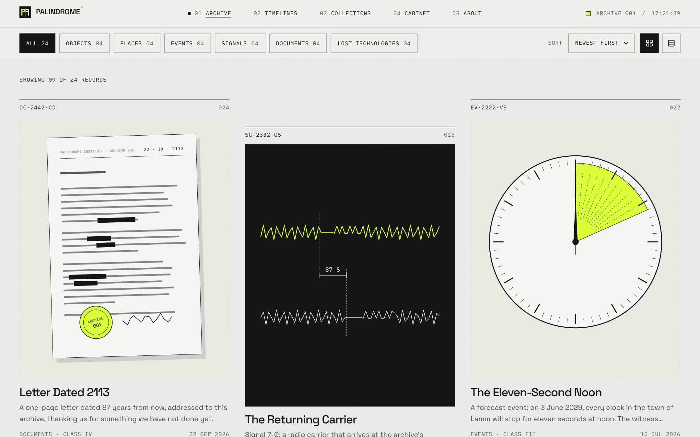
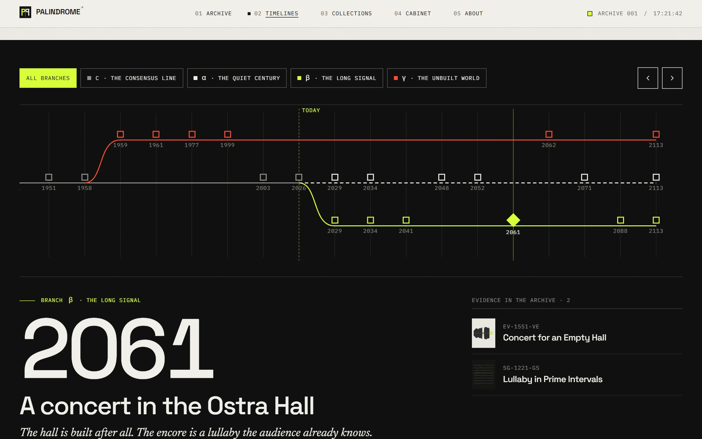
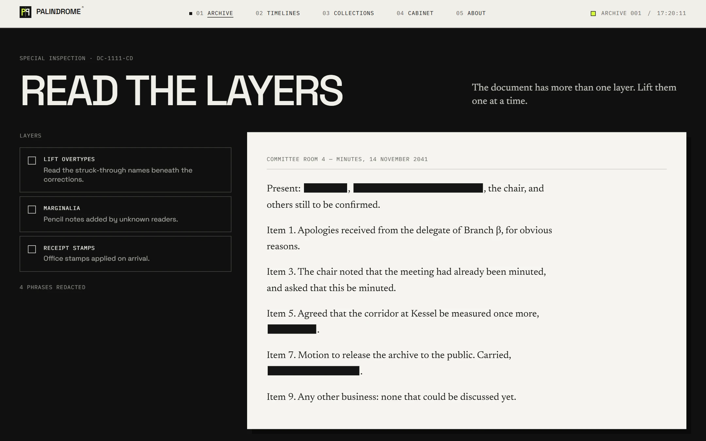
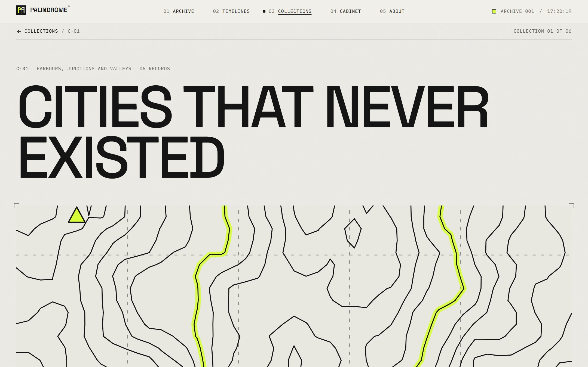
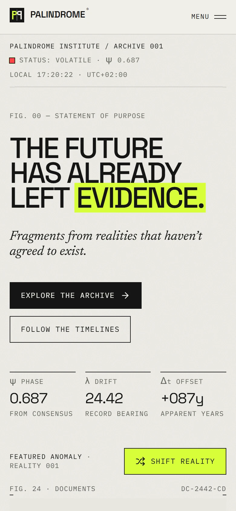
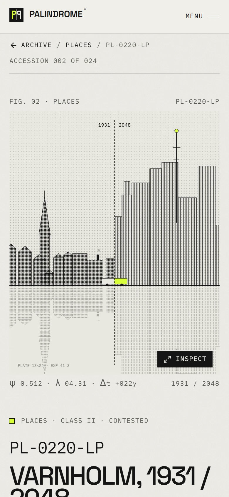
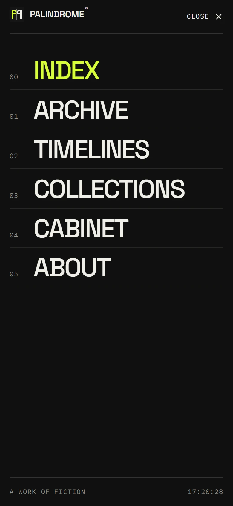

<div align="center">

# PALINDROME®

**Архив того, что ещё не произошло.**

Экспериментальный цифровой архив вымышленных артефактов, невозможных мест, будущих событий,<br />
перехваченных сигналов, недатированных документов и утраченных технологий.

### [→ Открыть архив](https://palindrome-archive.vercel.app)

[](https://github.com/NikitaMelnikit/palindrome-archive/actions/workflows/ci.yml)
[](https://palindrome-archive.vercel.app)


[](LICENSE)

[English](README.md) · **Русский**

<br />



</div>

<br />

## Об архиве

PALINDROME® хранит **24 записи** в **6 категориях**, связанные с **одной общепринятой хронологией и тремя
альтернативными ветками истории**. Каждая запись — это документация, а не доказательство. И каждая из них вымышлена.

- **Каждый идентификатор — палиндром.** `OB-2112-BO`, `PL-0220-LP`, `DC-2442-CD` читаются одинаково в обе стороны;
  это проверяется тестом.
- **Каждое изображение построено из данных.** Топографические карты, город, снятый в двух разных годах, циферблаты,
  осциллограммы, документы с цензурой, чертежи машин, лампа с двумя тенями — всё это детерминированный SVG. Никаких
  стоковых фото и внешних картинок.
- **Ничего не изображает успех.** «Поделиться», «Скопировать» и «Сохранить» сообщают о том, что произошло на самом
  деле; ошибки хранилища показываются, а не скрываются.

## Возможности

|                          |                                                                                                                 |
| ------------------------ | --------------------------------------------------------------------------------------------------------------- |
| **SHIFT REALITY**        | Меняет главный артефакт, ветку хронологии, статус и URL. Состоянием можно поделиться, оно переживает перезагрузку. |
| **Обозреватель архива**  | Поиск по названию, идентификатору, описанию и тегам; фильтры по категориям; три сортировки; сетка или список; «показать ещё». Всё состояние — в URL. |
| **Особые инспекции**     | Ползунок лет на разделённой фотографии, документ со снимаемой цензурой, карта с выбираемыми координатами, режимы просмотра. |
| **Режим инспекции**      | Полноэкранный просмотр с зумом, перетаскиванием, режимами plate / negative / spectral и аннотациями. Работает с клавиатуры, фокус возвращается. |
| **Ветвящиеся хронологии** | Перетаскиваемый график на десктопе и аккордеон на телефоне, навигация стрелками, прямые ссылки на каждое событие. |
| **Личный кабинет**       | Сохранённые записи и коллекции, недавно просмотренное, экспорт в JSON и очистка с подтверждением — в `localStorage` с валидацией. |

## Галерея

<table>
  <tr>
    <td width="50%"></td>
    <td width="50%"></td>
  </tr>
  <tr>
    <td align="center"><sub><b>Запись</b> — Varnholm, 1931 / 2048</sub></td>
    <td align="center"><sub><b>Режим инспекции</b> — спектральный режим и аннотации</sub></td>
  </tr>
  <tr>
    <td width="50%"></td>
    <td width="50%"></td>
  </tr>
  <tr>
    <td align="center"><sub><b>Архив</b> — поиск, фильтры, сортировка</sub></td>
    <td align="center"><sub><b>Хронологии</b> — общепринятая линия и три ветки</sub></td>
  </tr>
  <tr>
    <td width="50%"></td>
    <td width="50%"></td>
  </tr>
  <tr>
    <td align="center"><sub><b>Read the layers</b> — документ со снимаемой цензурой</sub></td>
    <td align="center"><sub><b>Коллекции</b> — кураторские маршруты по архиву</sub></td>
  </tr>
</table>

<table>
  <tr>
    <td width="33%"></td>
    <td width="33%"></td>
    <td width="33%"></td>
  </tr>
  <tr>
    <td align="center"><sub>Телефон — главная</sub></td>
    <td align="center"><sub>Телефон — запись</sub></td>
    <td align="center"><sub>Телефон — меню</sub></td>
  </tr>
</table>

## Технологии

| Слой         | Выбор                                                                                 |
| ------------ | ------------------------------------------------------------------------------------- |
| Фреймворк    | [Next.js 16](https://nextjs.org) App Router (Turbopack), React 19 Server Components   |
| Язык         | TypeScript в режиме `strict`                                                          |
| Стили        | Tailwind CSS 4 (токены в `@theme`) + собственный CSS для арт-дирекшна                 |
| Анимация     | [Motion](https://motion.dev) (`LazyMotion`), CSS scroll-driven анимации как улучшение |
| Валидация    | [Zod](https://zod.dev) — тесты целостности данных и чтение `localStorage`             |
| Иконки       | [Lucide](https://lucide.dev)                                                          |
| Тесты        | Vitest + Testing Library (jsdom)                                                      |
| Хостинг      | [Vercel](https://vercel.com) — каждый push в `main` выкатывается в продакшн           |

## Запуск

Нужны **Node.js 20.9+** (разработка велась на Node 24) и npm.

```bash
git clone https://github.com/NikitaMelnikit/palindrome-archive.git
cd palindrome-archive
npm install
npm run dev
```

Откройте <http://localhost:3000>.

| Команда             | Что делает                                               |
| ------------------- | -------------------------------------------------------- |
| `npm run dev`       | Сервер разработки (Turbopack)                            |
| `npm run build`     | Продакшн-сборка — 74 предрендеренные страницы            |
| `npm run start`     | Запуск продакшн-сборки                                   |
| `npm run lint`      | ESLint (правила Next.js core-web-vitals + TypeScript)    |
| `npm run typecheck` | Генерация типов маршрутов и `tsc --noEmit`               |
| `npm run test`      | Vitest — 72 теста                                        |
| `npm run check`     | lint → typecheck → test → build (то же, что в CI)        |

> В `.npmrc` включён `legacy-peer-deps=true`: резолвер peer-зависимостей npm 11 падает на этом дереве зависимостей
> (ошибка arborist `edgesOut`). Все нужные peer-пакеты явно перечислены в `package.json`, так что ничего не теряется.

## Качество

Измерено, а не заявлено — Lighthouse 13 на живом сайте в Vercel (11 октября 2026):

| Страница                      | Профиль                    | Performance | Accessibility | Best practices | SEO |
| ----------------------------- | -------------------------- | :---------: | :-----------: | :------------: | :-: |
| Главная                       | десктоп                    |     100     |      100      |      100       | 100 |
| Главная                       | телефон, медленный 4G      |     78      |      100      |      100       | 100 |
| Архив                         | телефон, медленный 4G      |     91      |      100      |      100       | 100 |
| Хронологии                    | телефон, медленный 4G      |     89      |      100      |      100       | 100 |
| Запись · Varnholm (3 прогона) | телефон, медленный 4G      |   68 – 93   |      100      |      100       | 100 |

CLS равен 0 на всех страницах, LCP на телефоне — 2,7–3,2 с. Оценка Performance на телефоне скачет между прогонами:
Total Blocking Time считается на процессоре машины, где запускается аудит, — одна и та же страница получила 93, 77
и 68. У кабинета SEO ниже намеренно — он закрыт от индексации (`noindex`).

## Деплой

Репозиторий подключён к Vercel: каждый push в `main` собирается и выкатывается в продакшн, для pull request’ов
создаются превью. Переменные окружения не нужны — канонические URL, `sitemap.xml` и `robots.txt` берут продакшн-домен,
который Vercel передаёт при сборке (`VERCEL_PROJECT_PRODUCTION_URL`), в том числе свой домен, если его подключить.
Чтобы задать адрес вручную, используйте `NEXT_PUBLIC_SITE_URL`.

[](https://vercel.com/new/clone?repository-url=https%3A%2F%2Fgithub.com%2FNikitaMelnikit%2Fpalindrome-archive)

## Ограничения

- Кабинет хранится в конкретном браузере (`localStorage`): аккаунтов и синхронизации нет.
- Производительность на телефоне в Lighthouse ограничена в основном JavaScript фреймворка (гидратацией) при эмуляции
  медленного 4G и замедленного в 4 раза процессора.
- Доступность проверялась через дерево доступности и автоматические аудиты, а не живым скринридером. Safari и Firefox
  вручную не тестировались.

## Лицензия

Код распространяется по [лицензии MIT](LICENSE). Подробности об архитектуре — в [английской версии](README.md#architecture-notes).

<div align="center">
<br />
<sub>Все записи, места, люди и учреждения в этом архиве вымышлены.</sub>
</div>
